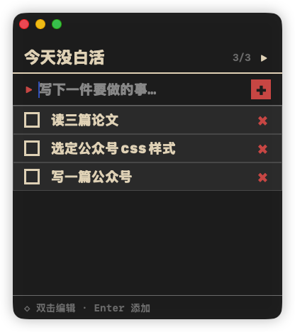

# 今天没白活

> 置顶浮动的像素风待办小窗 · a floating pixel-art todo app for macOS

一个一直飘在屏幕角落的小窗口，提醒你今天该做什么。写进去、做完了、划掉，一天就有了形状。

## 本仓库与来源

这是 leilong611-ai 维护的独立续作，原作者为 [lijigang](https://github.com/lijigang)，保留原 MIT 许可证及版权声明，不代表原作者官方发布。

2026-10-23 核对时，原仓库 `lijigang/JintianMeiBaihuo` 公开访问返回 404。本基线从公开副本 [yanhao2046/JintianMeiBaihuo](https://github.com/yanhao2046/JintianMeiBaihuo) 恢复；原始两次提交及全部对象已按 Git SHA 校验，基线为 `f71cfb989377471624df444be1d8609737c672dd`。不保证包含原仓库后续全部改动。截图属于原始基线。

当前仓库只包含公开源码与项目素材，不包含使用者的待办、设置或登录资料。下一版计划：窗口与字号设置、快捷键、每日归档和历史回顾、任务分类及提醒。

<p align="center">
  
</p>

## 核心特性

- 🪟 **置顶浮动** — 始终在所有窗口之上，随时看得到
- 🖱️ **可拖动** — 点背景随便拖到哪个角落
- 👻 **透明度可调** — 30%–100% 自由调，不挡事
- 🕹️ **像素风视觉** — 6 色复古调色板 + 重字重等宽字体 + 零圆角零阴影零动画
- 🔠 **大字体** — 默认 20pt，一眼看清
- 💾 **本地持久化** — 写到 `~/Library/Application Support/JintianMeiBaihuo/todos.json`，不联网

## 使用

- 回车 / 点「+」— 添加待办
- 点复选框 — 完成 / 取消完成
- 双击文字 — 编辑
- 点 × — 删除
- 点标题右侧「▶」— 展开/收起透明度滑块

## 安装

### 安装包状态

本续作尚未发布安装包。下方为源码构建方式；原作者 v1.0.0 安装包未在此重新发布。

> ⚠️ 未代码签名。首次启动会被 Gatekeeper 拦，解决办法：**右键点 app 图标 → 选「打开」→ 弹窗里再点一次「打开」**。之后正常双击即可。

### 方式二：从源码构建

需要 macOS 13+ 和 Xcode Command Line Tools。

```bash
git clone https://github.com/leilong611-ai/JintianMeiBaihuo.git
cd JintianMeiBaihuo
./build.sh
open "build/今天没白活.app"
```

打包 DMG：

```bash
./package-dmg.sh           # 默认 1.0.0
./package-dmg.sh 1.0.1     # 指定版本号
```

## 技术栈

- SwiftUI + AppKit (NSApplicationDelegate 配置 NSWindow)
- Foundation + Combine (JSON 持久化 + 防抖保存)
- 零第三方依赖
- 直接 `swiftc` 编译 + 手动组装 `.app` bundle（不依赖 Xcode 项目文件）

## 设计哲学

像素风不是装饰，是约束系统 —— 6 条不可再减的生成器：

1. **限定调色板**（≤6 色：黑底 / 深灰表面 / 米白字 / 朱砂红重点 / 抹茶绿完成 / 中灰辅助）
2. **零圆角 + 硬边框**（`cornerRadius = 0`，2–3pt solid）
3. **4/8 倍数间距**（所有 padding / margin 都走格点）
4. **重字重等宽字体**（`.monospaced + .heavy/.black`）
5. **Unicode 几何符号**（■ □ × ▸ ◇，不用 SF Symbols）
6. **零动画**（`.transaction { $0.animation = nil }`）

每一条都和 SwiftUI 的默认倾向（圆角、阴影、弹簧动画）作对。克制就是风格。

## License

MIT
